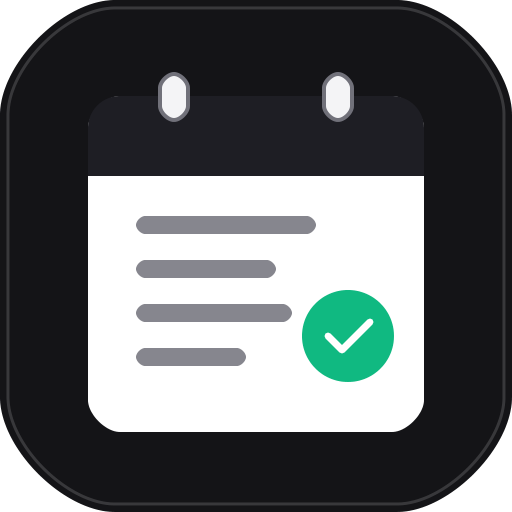

# ⚡ Blackboarder

<p align="center">
  
</p>

<p align="center">
  <strong>Deadline tracker and academic companion for Blackboard Learn</strong>
</p>

<p align="center">
  <a href="https://blackboarder.pages.dev/"></a>
  <a href="https://github.com/yvs1n/blackboarder-extension/releases/latest"></a>
  <a href="https://blackboarder.pages.dev/chrome-extension"></a>
  <a href="https://blackboarder.pages.dev/edge-extension"></a>
  <a href="https://blackboarder.pages.dev/firefox-extension"></a>
  <a href="https://github.com/yvs1n/blackboarder-extension/releases/latest"></a>
  <a href="#-phone-app-and-calendar"></a>
  <a href="#-development"></a>
  <a href="LICENSE"></a>
</p>

---

## 📖 What it is

Course announcements on Blackboard bury quiz dates, homework deadlines, exams and room changes inside long English or Arabic messages. **Blackboarder** reads them for you and turns them into one calendar of deadlines.

It was built at the **University of Sharjah** and works for any university on Blackboard Learn or Ultra: pick yours when you set it up (UOS, UAEU, ADU, ZU, AUD, AUS, AURAK, BUiD or Other), or scan any Blackboard page and it is filled in. Your university sets the GPA grading scale (and, for UOS, fills in its quick links). It has three parts that stay in sync:

| Part | What it does |
| :--- | :--- |
| **Browser extension** | Scans Blackboard, finds deadlines, and shows them in a popup or the browser's side panel. This repository is the extension. |
| **Phone app (PWA)** | The same calendar and deadlines on your phone, at [blackboarder.pages.dev/companion](https://blackboarder.pages.dev/companion/). Installs to the home screen and works offline. Sends deadline reminders. |
| **Calendar feed** | A live `.ics` link for Apple Calendar, Google Calendar or Outlook. |

Data syncs through **Firebase**, each student under their own private sync key. No account or sign-in is needed.

---

## 🌟 Features

- **Finds and updates deadlines automatically.** A primary built-in parser reads English and Arabic keywords (*quiz*, *assignment*, *midterm*, *كويز*, *واجب*, *امتحان*), dates, times, and classrooms offline, while an optional AI provider confirms ambiguous posts or helps on unformatted text (see Settings and AI Keys below). Singleton syllabus-category deduplication ensures unique deliverables such as `Final Exam` or single-item components never duplicate under generic titles like `Exam`, while multi-announcement updates append chronological `[Professor Update]` notes and reconcile modified fields in place.
- **Monthly calendar, uniform deadline summaries, and unified actions.** Monday-first grid, tasks sorted by time within each day, a standardized ordered Summary card (`When`, `Room`, `Weight`, `Topics`, `Rules`, optional `Score` and `Summary` brief) with a collapsible `Professor Notes` dropdown, and an identical action bar (`Mark Done`, `Edit`, `Share`, `Calendar`, `Delete`) across every view in both the extension and phone companion. The grid maintains the exact same height and width across 4, 5, and 6 row months without layout shifts.
- **Scans exam schedules.** Your midterm and final dates, times, rooms, exam methods and section overrides come from your university's exam schedule page (UOS: the Banner Student Exam Page), with syllabus weights. Scan on that page, or just Scan on Blackboard: it reads the exam page in a background tab (at most once an hour) while you are signed in to Banner.
- **Marks tab and academic tracking.** Dedicated Marks tab with student profile badge, semester bar with switcher and archiving tools, Dual-Column GPA Overview (Term SGPA, Cumulative CGPA, discrete combination rounding explanation, and Projected CGPA), Current Term Grades course cards with left color accent borders and mark breakdowns, collapsible Target Grade Breakdown accordion with momentum trends and interactive chips, and Syllabus Progress breakdown.
- **Target GPA and scholarship predictor.** Calculates required semester Term SGPA to achieve or retain university scholarship thresholds based on prior completed credits and starting GPA, with trajectory progress bars and achievable score ranges on remaining exams.
- **Multi-semester tracking and cumulative CGPA.** Snapshot and archive past terms, auto-partition legacy Blackboard courses by term codes (`_2510`, `_2610`), and track degree credit completion progress.
- **Payments and financial deadlines.** Dedicated **Payments** view from the header tracks tuition installments, verified UOS Banner/Tahseel portal links, and unpaid dues across the calendar, Deadlines strip, `.ics` feeds, and emoji-free reminders without skewing academic GPA. Can also import open Banner finance tables when scanning signed-in finance pages.
- **Courses tab.** One place for each course: name, code, colour, credit hours, class times and rooms, and the mark breakdown. The extension and the phone app have the same tab, and edits sync both ways.
- **Import your syllabus or schedule.** Courses > Import File reads a PDF, Word or text file (or pasted text) on your device and fills in courses, class times, rooms and assessment weights. You check each course before it is saved. With an AI set up, it reads the file first.
- **Class reminders.** A reminder a set time before each class (Settings > Alerts), and each day's classes on the calendar (turn off **Show My Classes** in Settings > Calendar to hide them).
- **Course schedule matching.** When an announcement does not name a room or time, Blackboarder fills it in from your weekly class schedule.
- **Same layout everywhere.** The extension and the phone app have the same tabs (Calendar, Deadlines, Marks, Courses) and the same Settings sections in the same order (General, Sync, Calendar, Alerts, Data, Updates), so a button is where you expect it on both.
- **Grade weights.** Shows how much each deliverable counts (for example *Midterm 25%*) on cards and in the calendar.
- **Marks from the Blackboard gradebook & bonus marks.** Every scan reads your gradebook and puts each mark on its deadline. Submitted items without a released grade stay marked as Submitted without false marks, and students can add bonus marks or quick scores (`+ Score`) with category targeting (**Bonus On What**).
- **Grades and GPA calculations.** Shows your projected Term SGPA and Cumulative CGPA on your university's grading scale (editable in Settings > General) with every mark under its course, newest first, and the share of the grade each one earned. GPA is weighted by credit hours, set per course. When a syllabus counts only the best items (for example best 2 of 3 quizzes), only the best ones count.
- **Syllabus progress.** In the Marks tab: for each course, how much of the syllabus weight is done, pending, or not announced yet.
- **Add deadlines quickly.** The course field lists your courses and narrows as you type. Closing the popup while adding or editing a deadline, in the Courses tab or in Settings, reopens right there.
- **Quick links.** Your own one-tap links to marks, attendance, your study plan or anything else, synced to the phone. A new install starts with none, since every student's links are different; UOS students get the UOS links filled in when the university is set.
- **Purposeful reminders before deadlines.** Emoji-free desktop and mobile alerts show exact time remaining (`Due in 1h 30m`), course, syllabus weight, schedule (`During class` vs specific time), and room or submission location.
- **Privacy tools.** Delete everything stored online under your sync key from Settings > Data, download a recovery file for your key, and see a banner when your Blackboard session has ended.
- **Zero-Knowledge Cloud Vault & Private Sync.** Synced tasks, courses, student profile, semesters, marks, and tombstones are sealed inside an authenticated, encrypted AES-256-GCM vault envelope (`v1:iv:ciphertext`) derived from your secret sync key via HKDF-SHA256 before storage in Firebase Realtime Database. Cloud administrators and database servers see zero plaintext academic records, while calendar feeds and push reminders continue working through memory-only decryption in the Cloudflare Worker. The sync key input is strictly read-only to prevent typing collisions. Generating a new key opens a confirmation modal with an instant Export JSON Backup button so you can save your data before resetting. If a phone connects to an old sync key whose data was deleted, it unpairs cleanly and returns to the pairing screen.
- **Mobile post-pairing setup.** Pairing your phone via QR code or sync key opens an onboarding setup sheet with immediate toggles for class visibility, push alerts, Apple and Google Calendar subscription links, and widget setup instructions.
- **Multi-Platform Widgets & Desktop Companion.** Bring your deadlines and courses to your home screen, lock screen, and desktop with a frosted glass aesthetic:
  - **iPhone and iPad**: Native Scriptable Home and Lock Screen frosted liquid glass widgets with student ID header, course color accent bars, and clear assessment hierarchy; auto-updates styling and layout from Blackboarder and caches locally offline.
  - **Android**: Live Web Widget frosted glass card and KWGT Kustom Widget integration.
  - **Windows and Mac**: Windows 11/10 native companion app (`BlackboarderWidget.exe` from the latest release or **Settings > General**) connecting directly via personal Sync Key (with student ID header and website-synced styling/content cached locally for offline use), and Mac desktop wallpaper 1-line Terminal setup in **Settings > General**.
  - **Hardware Detection**: Automatically detects your OS and device model to tailor setup instructions in extension **Settings > General** and companion **Settings > Calendar**.
- **Live scan cancellation.** Click the close button (`✕`) on the live scan banner to cancel active scans across background HTTP and tab scanners immediately.
- **Fast, responsive performance.** Smooth hardware-accelerated CSS view transitions, font preloading (`inter.woff2`, `inter-tight.woff2`), CSS containment (`contain: layout style paint`), and debounced search filtering.
- **Dark mode** for the extension, the phone app, and Blackboard itself.
- **Activity filter**: a bar on Blackboard's Activity page shows only the courses and kinds of item you pick (Exams & quizzes, Assignments & labs, Grades, Materials, Announcements), and keeps loading older items while a filter is on.
- **Course colours on Blackboard**: each course keeps the colour you set in Blackboarder on Blackboard too (Activity, calendar, Grades, Messages, the course banner and tabs). New courses start with Blackboard's own colour.
- **Automatic updates from GitHub**, checking GitHub via lightweight HTTP with toggleable auto-download, stale-file cleanup, and post-update changelog summaries (see [Automatic updates](#-automatic-updates)).

---

## 🚀 Quick Start & Installation

Works in **Chrome, Firefox, Edge, Brave, Opera and Vivaldi**.

### 1. Get the extension (or mobile scanner)

- **Browser Stores (Recommended):**
  - **Chrome / Brave / Opera / Vivaldi:** [Chrome Web Store](https://blackboarder.pages.dev/chrome-extension)
  - **Microsoft Edge:** [Edge Add-ons](https://blackboarder.pages.dev/edge-extension)
  - **Firefox (Desktop & Android):** [Firefox Add-ons](https://blackboarder.pages.dev/firefox-extension)
- **iPhone / iPad Safari:** Install the free **Userscripts** Safari extension and add [`blackboarder.user.js`](https://blackboarder.pages.dev/blackboarder.user.js) (see [blackboarder.pages.dev/#install](https://blackboarder.pages.dev/#install)).
- **GitHub Release (Unpacked / Auto-Updater):** Download **[`blackboarder-extension.zip`](https://github.com/yvs1n/blackboarder-extension/releases/latest)** from the latest release and unzip it somewhere permanent (for example `Documents\blackboarder`). Do not delete the folder afterwards; the browser loads the extension from it.
- **With git:** `git clone https://github.com/yvs1n/blackboarder-extension.git` (loads from `dist/`).

You do not need to build anything; everything is precompiled.

### 2. Load the extension

1. Open your browser's extensions page: `chrome://extensions`, `edge://extensions` or `brave://extensions`.
2. Turn on **Developer mode** (top right).
3. Click **Load unpacked** and select the unzipped folder (or the **`dist`** folder if using git).
4. Pin **Blackboarder** to the toolbar.

### 3. Configure updates in Settings

Open **Settings > Updates** inside the Blackboarder extension:
- **Automatic Updates** (on by default): automatically downloads new GitHub builds and reloads when idle.
- **Show Changelog After Update** (on by default): opens a **What's New** summary the first time you open Blackboarder after an update.
- Click **Check for Updates**, **Update Now**, or **Download Latest Extension (.zip)** anytime; all tasks, courses, and sync key stay intact.

### 4. Use it

1. Open Blackboard (for UOS: `https://elearning.sharjah.ac.ae/ultra/stream`).
2. Click the floating **Scan Blackboard** button (the lightning bolt at the bottom right), or press **Alt+B** (**Option+Shift+B** on Mac) to open the popup.
3. To keep Blackboarder open next to the page, open it in the browser's **side panel**.

---

## 📱 Phone App and Calendar

The phone app is at **`https://blackboarder.pages.dev/companion/`**. The site root, `blackboarder.pages.dev`, is the project's landing page.

1. On your phone, open `blackboarder.pages.dev/companion` in Safari or Chrome (it is a web app, not in the App Store or Play Store) and add it to your home screen: **Share > Add to Home Screen** on iPhone, or **Install app** in Chrome on Android.
2. In the extension, open **Settings > Sync** and click **Show Pairing QR Code**.
3. In the phone app, tap **Scan QR** (in the Setup Guide or **Settings > Sync**) and point the camera at the code. It pairs with your sync key, AI included, and loads your deadlines. No camera? Click **Copy Phone Pairing Link** instead and open it on the phone, or paste it into the sync key box.
4. To get deadlines and classes in your calendar, open **Settings > Calendar**, choose what it shows (**Deadlines and classes**, **Deadlines only** or **Class schedule only**) and click **Copy Calendar Link** (or **Subscribe in Apple Calendar** in the phone app):
   - **Apple Calendar:** opening the `webcal://` link asks to subscribe.
   - **Google Calendar:** on a computer, go to **Other calendars > + > From URL** and paste the `https://.../feed.ics?key=...` link.

The calendar link includes your sync key. Links without a key are rejected, so if an old subscription stops updating, copy the link again and re-subscribe.

---

## ⚙️ Settings and AI Keys

No API key? The built-in parser reads announcements automatically, so everything works without one. A key only adds an AI model for long or vague announcements. Set the model and key in the **extension** (Settings > Scanning); the phone app uses the same one and never holds the key.

| Setting | What it is for | Default |
| :--- | :--- | :--- |
| **AI provider** | OpenRouter, IFM K2 Horizon (free daily tokens from platform.ifm.ai), or any OpenAI-compatible API (base URL and model name). Each keeps its own key, and **Test connection** checks it | OpenRouter |
| **API key** | AI extraction for long or vague announcements | Empty (optional) |
| **AI model** | Model used through OpenRouter | `google/gemini-3.8-flash` |
| **Auto-scan** | Scans announcements when a Blackboard page loads | On |
| **Theme** | Light, dark, or match the system | Match the system |
| **University** | Grading scale for the GPA, and the built-in quick links (UOS only) (Settings > General) | Set by the first scan, else UOS |
| **Show My Classes** | Each day's classes on Blackboarder's calendar (Settings > Calendar) | On |
| **Calendar Link Shows** | What the subscription link shows: deadlines and classes, deadlines only, or classes only (Settings > Calendar) | Deadlines and classes |
| **Class Reminders** | A reminder before each class (Settings > Alerts) | 15 minutes before |

---

## 🔄 Automatic Updates

Updates are configured directly inside **Settings > Updates**:

- **Background checks:** The extension checks this repository every 15 minutes using lightweight HTTP without running background processes.
- **In-place upgrades:** Clones on a clean `main` branch and unpacked installs that registered the local helper once (`update.bat` on Windows or `./update.sh` on macOS/Linux) replace updated files cleanly in place and reload immediately when you click **Update now** (or auto-restart when idle when **Automatic Updates** is on). Otherwise download and extract the latest ZIP while keeping all tasks, courses, and settings intact.
- **What's New changelog:** Toggle **Show Changelog After Update** in **Settings > Updates**, or expand the changelog section there anytime. All your tasks, courses, profile, and settings are 100% kept.

Each build is identified by a hash of its files, so a change that does not touch the extension does not update it.

---

## 🧪 Development

```bash
npm install        # install dependencies
npm run build      # build dist/ and sync versions
npm run lint       # type-check plus style, JSON and version-sync checks
npm test           # run the Vitest suite
npm run package    # build the release zip into release/
```

This repository is published from a private source repository, so changes made directly here are overwritten by the next publish. Bug reports and ideas are welcome as issues.

- **Source:** `src/` (TypeScript), `public/` (manifest and icons), `updater/` (update helper).
- **Generated:** `dist/`, the `version.json` files and `src/buildInfo.ts`.

[`AGENTS.md`](AGENTS.md) lists what is where and the rules the code follows.

---

## 📂 Project Structure

```text
blackboarder-extension/
|-- src/                  Extension source (TypeScript)
|   |-- popup/            Popup and side panel (modules/, styles/)
|   |-- content/          Scraper and dark mode for Blackboard pages
|   |-- background/       Background worker: sync, reminders, automatic updates
|   |-- scan/             Shared Blackboard API readers and scan pipeline
|   |-- engine/           Deadline detection: local parser, then an optional AI model
|   |-- core/             Courses, weights, schedules
|   `-- utils/            Storage (storage/), Firebase sync, calendar, task merging
|
|-- dist/                 Built extension; load this folder (generated)
|-- updater/              Optional native update helper (copied into dist/ by the build)
|-- update.bat, update.sh Optional one-time updater registration
|-- windows-widget/       Windows 10/11 desktop & lock screen companion source (BlackboarderWidget.exe)
|-- public/               Extension manifest template and icons
|-- scripts/              Build, lint and packaging scripts
|-- tests/                Automated tests
|-- docs/                 Install guide
|
|-- CHANGELOG.md          Release notes
`-- AGENTS.md             Project map and rules for contributors and coding agents
```

**Guides:** [Install the extension](docs/INSTALL_EXTENSION.md) | [Website](https://blackboarder.pages.dev/) | [Supported Universities](https://blackboarder.pages.dev/universities/)

---

## 📄 License

The extension is open source under the [MIT License](LICENSE). The website ([blackboarder.pages.dev](https://blackboarder.pages.dev)) and phone app ([blackboarder.pages.dev/companion](https://blackboarder.pages.dev/companion/)) are a separate hosted service.
