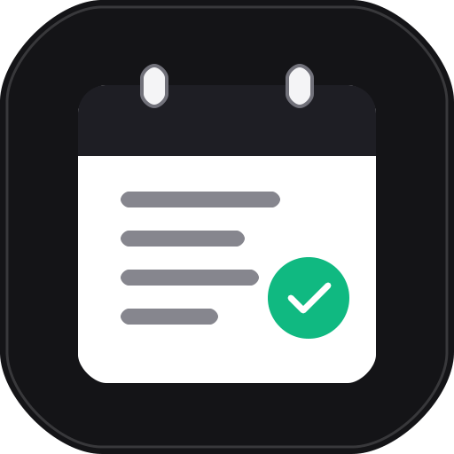

# ⚡ Blackboarder

<p align="center">
  
</p>

<p align="center">
  <strong>Deadline tracker and academic companion for Blackboard Learn</strong>
</p>

<p align="center">
  <a href="https://github.com/yvs1n/blackboarder-extension/releases/latest"></a>
  <a href="https://github.com/yvs1n/blackboarder-extension/releases/latest"></a>
  <a href="#-quick-start--installation"></a>
  <a href="#-phone-app-and-calendar"></a>
  <a href="#-development"></a>
  <a href="LICENSE"></a>
</p>

---

## 📖 What it is

Course announcements on Blackboard bury quiz dates, homework deadlines, exams and room changes inside long English or Arabic messages. **Blackboarder** reads them for you and turns them into one calendar of deadlines.

It was built at the **University of Sharjah** and works for any university on Blackboard Learn or Ultra: pick yours when you set it up (UOS, UAEU, ADU, ZU, AUD, AUS, AURAK or Other), or scan any Blackboard page and it is filled in. Your university sets the GPA grading scale (and, for UOS, fills in its quick links). It has three parts that stay in sync:

| Part | What it does |
| :--- | :--- |
| **Browser extension** | Scans Blackboard, finds deadlines, and shows them in a popup or the browser's side panel. This repository is the extension. |
| **Phone app (PWA)** | The same calendar and deadlines on your phone, at [blackboarder.pages.dev](https://blackboarder.pages.dev). Installs to the home screen and works offline. Sends deadline reminders. |
| **Calendar feed** | A live `.ics` link for Apple Calendar, Google Calendar or Outlook. |

Data syncs through **Firebase**, each student under their own private sync key. No account or sign-in is needed.

---

## 🌟 Features

- **Finds deadlines automatically.** A local parser reads English and Arabic keywords (*quiz*, *assignment*, *midterm*, *كويز*, *واجب*, *امتحان*) and dates such as `Oct 15`, `18/10/2026` or `next Sunday`. Optional AI steps handle vague or long announcements (see Settings and AI Keys below).
- **Monthly calendar and deadline list.** Monday-first grid, tasks sorted by time within each day, and a day view with the full announcement, room, grade weight and your notes. The grid maintains the exact same height and width across 4, 5, and 6 row months without layout shifts.
- **Scans exam schedules.** Your midterm and final dates, times, rooms, exam methods and section overrides come from your university's exam schedule page (UOS: the Banner Student Exam Page), with syllabus weights. Scan on that page, or just Scan on Blackboard: it reads the exam page in a background tab (at most once an hour) while you are signed in to Banner.
- **Marks tab and academic tracking.** Dedicated Marks tab with student profile badge, semester bar with switcher and archiving tools, Dual-Column GPA Overview (Term SGPA, Cumulative CGPA, discrete combination rounding explanation, and Projected CGPA), Current Term Grades course cards with left color accent borders and mark breakdowns, collapsible Target Grade Breakdown accordion with momentum trends and interactive chips, and Syllabus Progress breakdown.
- **Target GPA and scholarship predictor.** Calculates required semester Term SGPA to achieve or retain university scholarship thresholds based on prior completed credits and starting GPA, with trajectory progress bars and achievable score ranges on remaining exams.
- **Multi-semester tracking and cumulative CGPA.** Snapshot and archive past terms, auto-partition legacy Blackboard courses by term codes (`_2510`, `_2610`), and track degree credit completion progress.
- **Courses tab.** One place for each course: name, code, colour, credit hours, class times and rooms, and the mark breakdown. The extension and the phone app have the same tab, and edits sync both ways.
- **Import your syllabus or schedule.** Courses > Import File reads a PDF, Word or text file (or pasted text) on your device and fills in courses, class times, rooms and assessment weights. You check each course before it is saved. With an AI set up, it reads the file first.
- **Class reminders.** A reminder a set time before each class (Settings > Alerts), and each day's classes on the calendar (turn off **Show My Classes** in Settings > Calendar to hide them).
- **Course schedule matching.** When an announcement does not name a room or time, Blackboarder fills it in from your weekly class schedule.
- **Same layout everywhere.** The extension and the phone app have the same tabs (Calendar, Deadlines, Marks, Courses) and the same Settings sections in the same order (General, Sync, Calendar, Alerts, Data, Updates), so a button is where you expect it on both.
- **Grade weights.** Shows how much each deliverable counts (for example *Midterm 25%*) on cards and in the calendar.
- **Marks from the Blackboard gradebook.** Every scan reads your gradebook and puts each mark on its deadline. Submitted items without a released grade stay marked as Submitted without false marks.
- **Grades and GPA calculations.** Shows your projected Term SGPA and Cumulative CGPA on your university's grading scale (editable in Settings > General) with every mark under its course, newest first, and the share of the grade each one earned. GPA is weighted by credit hours, set per course. When a syllabus counts only the best items (for example best 2 of 3 quizzes), only the best ones count.
- **Syllabus progress.** In the Marks tab: for each course, how much of the syllabus weight is done, pending, or not announced yet.
- **Add deadlines quickly.** The course field lists your courses and narrows as you type. Closing the popup while adding or editing a deadline, in the Courses tab or in Settings, reopens right there.
- **Quick links.** Your own one-tap links to marks, attendance, your study plan or anything else, synced to the phone. A new install starts with none, since every student's links are different; UOS students get the UOS links filled in when the university is set.
- **Reminders before deadlines.** The phone app reminds you a set time before each deadline, again shortly before, and when it is due (timings in Settings > Alerts).
- **Privacy tools.** Delete everything stored online under your sync key from Settings > Data, download a recovery file for your key, and see a banner when your Blackboard session has ended.
- **Private sync and data safety.** Every install gets its own sync key (`BBS-` plus 26 random characters). The sync key input is strictly read-only to prevent typing collisions. Generating a new key opens a confirmation modal with an instant Export JSON Backup button so you can save your data before resetting. If a phone connects to an old sync key whose data was deleted, it unpairs cleanly and returns to the pairing screen.
- **Mobile post-pairing setup.** Pairing your phone via QR code or sync key opens an onboarding setup sheet with immediate toggles for class visibility, push alerts, Apple and Google Calendar subscription links, and widget setup instructions.
- **Student ID and widgets.** Shows student identity (student ID, GPA, and enrolled courses) in the Courses tab, Blackboard Ultra stream badge, and Scriptable widgets (`Blackboarder • <ID>`).
- **Live scan cancellation.** Click the close button (`✕`) on the live scan banner to cancel active scans across background HTTP and tab scanners immediately.
- **Fast, responsive performance.** Smooth hardware-accelerated CSS view transitions, font preloading (`inter.woff2`, `inter-tight.woff2`), virtualized card rendering (`content-visibility: auto`), and debounced search filtering.
- **Dark mode** for the extension, the phone app, and Blackboard itself.
- **Activity filter**: a bar on Blackboard's Activity page shows only the courses and kinds of item you pick (Exams & quizzes, Assignments & labs, Grades, Materials, Announcements), and keeps loading older items while a filter is on.
- **Course colours on Blackboard**: each course keeps the colour you set in Blackboarder on Blackboard too (Activity, calendar, Grades, Messages, the course banner and tabs). New courses start with Blackboard's own colour.
- **Updates from GitHub with one click**, checking GitHub via lightweight HTTP and updating when you click Update now (see [Automatic updates](#-automatic-updates)).

---

## 🚀 Quick Start & Installation

Works in **Chrome, Firefox, Edge, Brave, Opera and Vivaldi**.

### 1. Get the files

- **GitHub Release (Recommended):** Download **[`blackboarder-extension.zip`](https://github.com/yvs1n/blackboarder-extension/releases/latest)** from the latest release and unzip it somewhere permanent (for example `Documents\blackboarder`). Do not delete the folder afterwards; the browser loads the extension from it.
- **With git:** `git clone https://github.com/yvs1n/blackboarder-extension.git` (loads from `dist/`).

You do not need to build anything; everything is precompiled.

### 2. Load the extension

1. Open your browser's extensions page: `chrome://extensions`, `edge://extensions` or `brave://extensions`.
2. Turn on **Developer mode** (top right).
3. Click **Load unpacked** and select the unzipped folder (or the **`dist`** folder if using git).
4. Pin **Blackboarder** to the toolbar.

### 3. Turn on automatic updates (once)

- **Windows:** double-click **`update.bat`** in the project folder.
- **macOS / Linux:** run `./update.sh` in the project folder.

This registers a small helper that lets the extension update itself whenever a new version is published here. Then go back to the extensions page and click the reload arrow on Blackboarder once. Your tasks, courses and sync key are kept.

### 4. Use it

1. Open Blackboard (for UOS: `https://elearning.sharjah.ac.ae/ultra/stream`).
2. Click the floating **Scan Blackboard** button (the lightning bolt at the bottom right), or press **Alt+B** (**Option+Shift+B** on Mac) to open the popup.
3. To keep Blackboarder open next to the page, open it in the browser's **side panel**.

---

## 📱 Phone App and Calendar

The phone app is at **`https://blackboarder.pages.dev/companion/`**. The site root, `blackboarder.pages.dev`, is the project's landing page.

1. On your phone, open `blackboarder.pages.dev/companion` in Safari or Chrome (it is a web app, not in the App Store or Play Store) and add it to your home screen: **Share > Add to Home Screen** on iPhone, or **Install app** in Chrome on Android.
2. In the extension, open **Settings > Sync** and click **Show Pairing QR Code**.
3. In the phone app, tap **Scan QR** (in the Setup Guide or **Settings > Sync**) and point the camera at the code. It pairs with your sync key, AI included, and loads your deadlines. No camera? Click **Copy Phone Pairing Link** instead and open it on the phone, or paste it into the sync key box.
4. To get deadlines and classes in your calendar, open **Settings > Calendar**, choose what it shows (**Deadlines and classes**, **Deadlines only** or **Class schedule only**) and click **Copy Calendar Link** (or **Subscribe in Apple Calendar** in the phone app):
   - **Apple Calendar:** opening the `webcal://` link asks to subscribe.
   - **Google Calendar:** on a computer, go to **Other calendars > + > From URL** and paste the `https://.../feed.ics?key=...` link.

The calendar link includes your sync key. Links without a key are rejected, so if an old subscription stops updating, copy the link again and re-subscribe.

---

## ⚙️ Settings and AI Keys

No API key? The built-in parser reads announcements automatically, so everything works without one. A key only adds an AI model for long or vague announcements. Set the model and key in the **extension** (Settings > Scanning); the phone app uses the same one and never holds the key.

| Setting | What it is for | Default |
| :--- | :--- | :--- |
| **AI provider** | OpenRouter, IFM K2 Horizon (free daily tokens from platform.ifm.ai), or any OpenAI-compatible API (base URL and model name). Each keeps its own key, and **Test connection** checks it | OpenRouter |
| **API key** | AI extraction for long or vague announcements | Empty (optional) |
| **AI model** | Model used through OpenRouter | `google/gemini-3.8-flash` |
| **Auto-scan** | Scans announcements when a Blackboard page loads | On |
| **Theme** | Light, dark, or match the system | Match the system |
| **University** | Grading scale for the GPA, and the built-in quick links (UOS only) (Settings > General) | Set by the first scan, else UOS |
| **Show My Classes** | Each day's classes on Blackboarder's calendar (Settings > Calendar) | On |
| **Calendar Link Shows** | What the subscription link shows: deadlines and classes, deadlines only, or classes only (Settings > Calendar) | Deadlines and classes |
| **Class Reminders** | A reminder before each class (Settings > Alerts) | 15 minutes before |

---

## 🔄 Automatic Updates

Once `update.bat` / `update.sh` has run, the extension checks this repository every 15 minutes using lightweight HTTP without running background processes. When a new build is detected, an **Update Available** banner appears with an **Update now** button. Clicking it asks the helper to download the new build into the extension folder (or run `git pull --ff-only` in a git clone on `main` without uncommitted edits), and restarts once its popup is closed or when you click **Restart now**. All your tasks, courses, profile, and settings are 100% kept. Otherwise **Settings** shows why it skipped.

Each build is identified by a hash of its files, so a change that does not touch the extension does not update it.

---

## 🧪 Development

```bash
npm install        # install dependencies
npm run build      # build dist/ and sync versions
npm run lint       # type-check plus style, JSON and version-sync checks
npm test           # run the Vitest suite
npm run package    # build the release zip into release/
```

This repository is published from a private source repository, so changes made directly here are overwritten by the next publish. Bug reports and ideas are welcome as issues.

- **Source:** `src/` (TypeScript), `public/` (manifest and icons), `updater/` (update helper).
- **Generated:** `dist/`, the `version.json` files and `src/buildInfo.ts`.

[`AGENTS.md`](AGENTS.md) lists what is where and the rules the code follows.

---

## 📂 Project Structure

```text
blackboarder-extension/
|-- src/                  Extension source (TypeScript)
|   |-- popup/            Popup and side panel
|   |-- content/          Scraper and dark mode for Blackboard pages
|   |-- background/       Background worker: sync, reminders, automatic updates
|   |-- engine/           Deadline detection: local parser, then an optional AI model
|   |-- core/             Courses, weights, schedules
|   `-- utils/            Storage, Firebase sync, calendar, task merging
|
|-- dist/                 Built extension; load this folder (generated)
|-- updater/              Update helper (copied into dist/ by the build)
|-- update.bat, update.sh Turn on automatic updates (run once)
|-- public/               Extension manifest template and icons
|-- scripts/              Build, lint and packaging scripts
|-- tests/                Automated tests
|-- docs/                 Install guide
|
|-- CHANGELOG.md          Release notes
`-- AGENTS.md             Project map and rules for contributors and coding agents
```

**Guides:** [Install the extension](docs/INSTALL_EXTENSION.md)

---

## 📄 License

The extension is open source under the [MIT License](LICENSE). The phone app and website at blackboarder.pages.dev are a separate hosted service.
